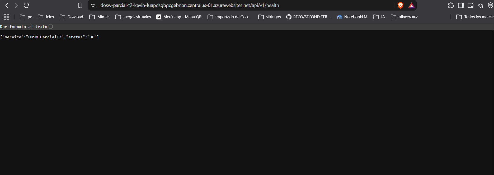
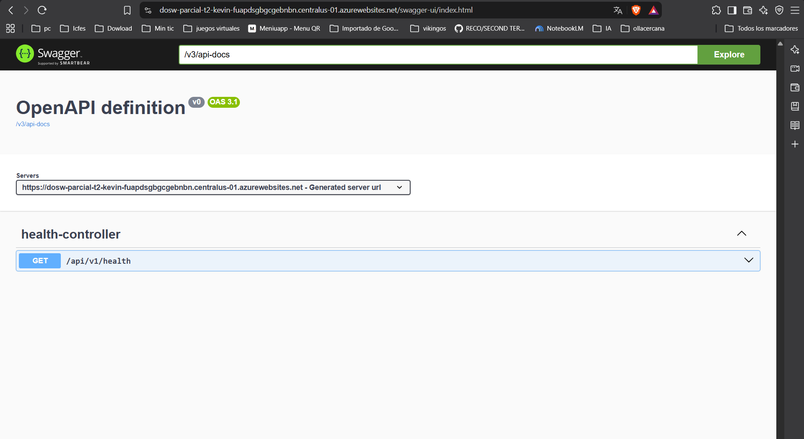
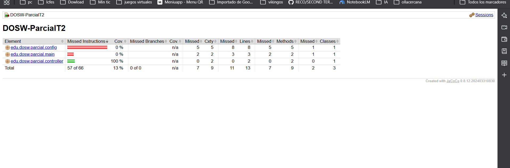
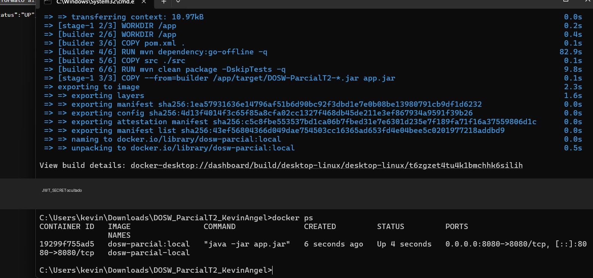
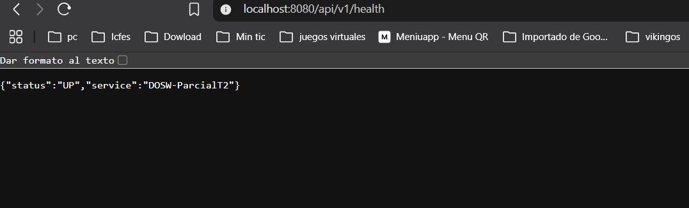
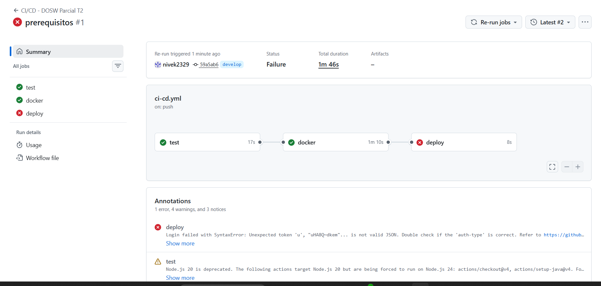
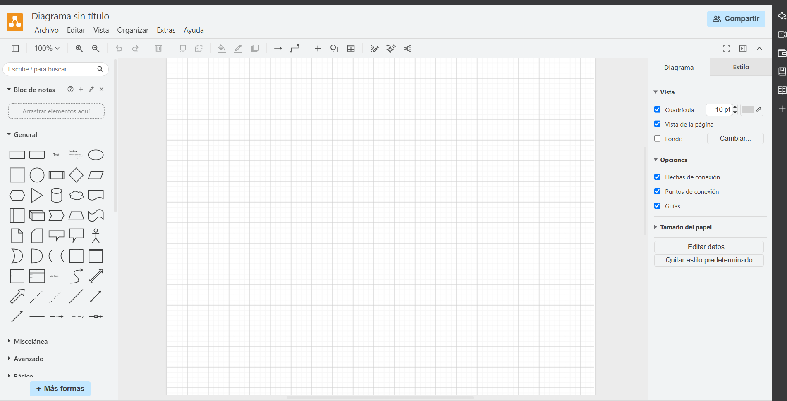
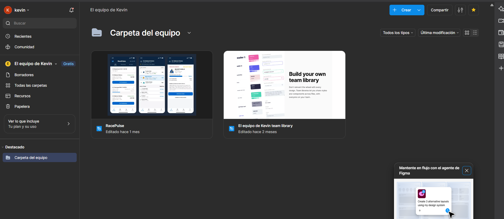

# DOSW_ParcialT2_KevinAngel

## Índice

1. [Datos del estudiante](#1-datos-del-estudiante)
2. [Descripción del proyecto](#2-descripción-del-proyecto)
3. [Despliegue](#3-despliegue)
4. [Estructura del proyecto](#4-estructura-del-proyecto)
5. [Tecnologías y dependencias](#5-tecnologías-y-dependencias)
6. [Configuración y variables de entorno](#6-configuración-y-variables-de-entorno)
7. [Cómo ejecutar](#7-cómo-ejecutar)
8. [Pruebas](#8-pruebas)
9. [Docker](#9-docker)
10. [CI/CD](#10-cicd)
11. [Herramientas de modelado y diseño (evidencias)](#11-herramientas-de-modelado-y-diseño-evidencias)


## 1. Datos del estudiante

- **Nombre completo:** Kevin Andrey Angel Acevedo,santiago andres garcia
- **Grupo:** 1
- **Profesor:** andres martin cantor

## 2. Descripción del proyecto

Servicio REST base para el parcial práctico del segundo tercio de DOSW. Incluye una estructura MVC, persistencia preparada para MongoDB, validación, seguridad con Spring Security, documentación OpenAPI y un endpoint de salud. La funcionalidad de negocio se construirá durante el laboratorio.

## 3. Despliegue

- **Servicio Azure:** [DOSW Parcial T2](https://dosw-parcial-t2-kevin-fuapdsgbgcgebnbn.centralus-01.azurewebsites.net)
- **Health:** [GET /api/v1/health](https://dosw-parcial-t2-kevin-fuapdsgbgcgebnbn.centralus-01.azurewebsites.net/api/v1/health) — verificado, responde `{"service":"DOSW-ParcialT2","status":"UP"}`.
- **Swagger:** [Swagger UI](https://dosw-parcial-t2-kevin-fuapdsgbgcgebnbn.centralus-01.azurewebsites.net/swagger-ui/index.html) — verificado.





## 4. Estructura del proyecto

```text
docs/                                      Diagramas, imágenes y evidencias
├── images/
└── uml/
src/main/java/edu/dosw/parcial/
├── config/                                Configuración de Spring y seguridad
├── controller/
│   ├── dtos/request/                      DTOs de entrada
│   ├── dtos/response/                     DTOs de salida
│   ├── handlers/                          Manejo global de errores
│   └── mappers/                           Mapeo entre DTOs y dominio
├── core/
│   ├── models/                             Modelos de dominio
│   ├── services/                           Casos de uso
│   ├── utils/                              Utilidades
│   └── validators/                         Validaciones de dominio
├── main/                                  Clase de inicio de Spring Boot
└── persistence/
    ├── entities/                           Documentos MongoDB
    ├── mappers/                            Mapeo entre dominio y documentos
    └── repositories/                       Repositorios MongoDB
src/main/resources/                         Configuración de la aplicación
src/test/java/edu/dosw/parcial/             Pruebas unitarias
src/test/resources/                         Recursos de pruebas
```

El Mapper IN convierte DTOs en objetos de dominio y viceversa. El Mapper OUT convierte entre dominio y documentos MongoDB. Los controladores no dependen de documentos de persistencia.


## 5. Tecnologías y dependencias

| Tecnología | Versión | Uso |
|---|---:|---|
| Java | 21 | Lenguaje y runtime |
| Spring Boot | 3.5.16 | Aplicación y servicios REST |
| Spring Data MongoDB | BOM de Spring Boot | Persistencia documental |
| Spring Security | BOM de Spring Boot | Seguridad HTTP |
| JJWT | 0.12.6 | Soporte para tokens JWT |
| Springdoc OpenAPI | 2.8.5 | Swagger UI y OpenAPI |
| MapStruct | 1.5.5.Final | Mapeo de objetos |
| Lombok | BOM de Spring Boot | Reducción de código repetitivo |
| JUnit / Mockito | BOM de Spring Boot | Pruebas |
| JaCoCo | 0.8.12 | Reporte de cobertura |
| Sonar Maven Plugin | 3.10.0.2594 | Análisis SonarQube |
| Docker | Multi-stage, Java 21 | Empaquetado del servicio |

## 6. Configuración y variables de entorno

| Variable | Descripción | Ejemplo ficticio |
|---|---|---|
| `MONGODB_URI` | URI de conexión a MongoDB | `mongodb://localhost:27017/dosw_parcial` |
| `JWT_SECRET` | Secreto JWT codificado en Base64 (mínimo 44 caracteres) | `<secreto-base64-de-44-caracteres>` |
| `PORT` | Puerto HTTP | `8080` |
| `DOCKERHUB_USERNAME` | Usuario de Docker Hub, como secret de GitHub | `<usuario>` |
| `DOCKERHUB_TOKEN` | Token de acceso de Docker Hub, como secret de GitHub | `<token>` |
| `AZURE_CREDENTIALS` | JSON del Service Principal, como secret de GitHub | `<json-del-service-principal>` |
| `AZURE_WEBAPP_NAME` | Nombre del App Service, como secret de GitHub | `<nombre-app>` |

No guardar credenciales reales en archivos versionados. En Azure también configurar `MONGODB_URI`, `JWT_SECRET` y `WEBSITES_PORT=8080` en Application settings.

## 7. Cómo ejecutar

Requiere Java 21, Maven 3.9+ y MongoDB local o accesible.

```powershell
# Iniciar MongoDB local con Docker
docker run -d -p 27017:27017 --name mongo-parcial mongo:7

# Definir un secreto Base64 local temporal de 48 bytes (PowerShell)
[byte[]]$secretBytes = 1..48 | ForEach-Object { Get-Random -Maximum 256 }
$env:JWT_SECRET = [Convert]::ToBase64String($secretBytes)

# Ejecutar con Maven
mvn spring-boot:run
```

El servicio escucha en `http://localhost:8080`. El endpoint `GET /api/v1/health` devuelve estado y nombre del servicio.

## 8. Pruebas

```powershell
mvn test
mvn clean verify
```

`mvn clean verify` pasó con 1 prueba. JaCoCo genera el reporte HTML en `target/site/jacoco/index.html`; la captura muestra la cobertura actual del scaffolding (13%).



El análisis SonarQube se puede ejecutar con `mvn sonar:sonar -Dsonar.host.url=<url-del-servidor> -Dsonar.token=<token>`; configurar la URL y el token fuera del repositorio.

## 9. Docker

```powershell
docker build -t dosw-parcial:local .
$env:JWT_SECRET = [Convert]::ToBase64String([byte[]](1..48 | ForEach-Object { Get-Random -Maximum 256 }))
docker run --rm -p 8080:8080 -e JWT_SECRET=$env:JWT_SECRET dosw-parcial:local
```

Para utilizar otra base de datos, pasar también `-e MONGODB_URI='<uri-de-mongodb>'`.





## 10. CI/CD

El workflow [`.github/workflows/ci-cd.yml`](.github/workflows/ci-cd.yml) ejecuta `mvn verify` en los pushes a `main` y `develop`, publica la imagen `dosw-parcial-t2:latest` en Docker Hub y la despliega en Azure App Service. Requiere los secrets `DOCKERHUB_USERNAME`, `DOCKERHUB_TOKEN`, `AZURE_CREDENTIALS`, `AZURE_WEBAPP_NAME` y `JWT_SECRET`. El workflow terminó correctamente con los jobs `test`, `docker` y `deploy` en verde.



## 11. Herramientas de modelado y diseño (evidencias)

- Herramienta de modelado elegida: Draw.io.
- Diseño de interfaces: Figma.






